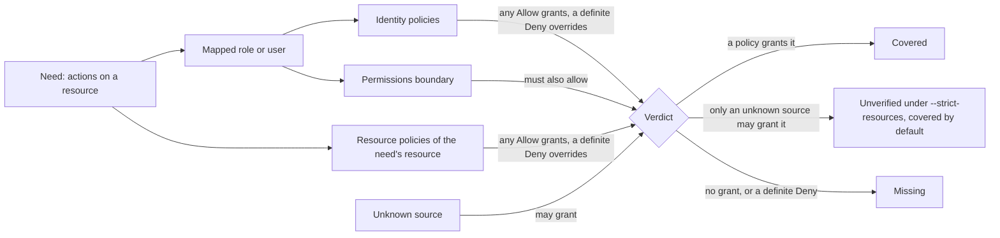

# PermCheck

[](https://deepwiki.com/elecnix/terraform-permcheck)

**Pre-apply IAM policy validation for Terraform — cloud-agnostic.**

PermCheck ensures your Terraform deploy role has the permissions required
by **every resource** in the plan, **before** `terraform apply` touches a
single cloud API. It cross-references the plan's resource types against your
declared IAM policies using each cloud's native schema registry.

```
terraform plan -out=plan.tfplan
terraform show -json plan.tfplan | terraform-permcheck validate \
  --policy-file deploy_policy.json --cloud aws
```

`deploy_policy.json` is the IAM policy document of the deploy role. To check a
policy that the plan itself defines, pass `--policy-from-plan-output NAME` in
place of `--policy-file`. See [Usage](#usage) for every input mode.

If your deploy role is missing `kms:CreateGrant` for a `aws_backup_vault`, you
find out at plan time — not 3 failed deploys later.

## Motivation

Writing least-privilege IAM policies for a Terraform deploy role is tedious and
error-prone. Every new resource type needs its own set of API permissions, and
those permissions are scattered across AWS/GCP/Azure docs. PermCheck automates
the cross-reference:

1. Parses the `terraform plan -json` to extract every resource type being
   created, updated, or deleted.
2. Maps each terraform resource type to its cloud-native equivalent (e.g.,
   `aws_backup_vault` → `AWS::Backup::BackupVault`).
3. Fetches the required IAM permissions from the cloud's schema registry
   (CloudFormation Resource Schema for AWS, Resource Manager for GCP,
   Resource Provider schemas for Azure).
4. Diffs against your declared IAM policy documents.
5. Fails the pipeline if any required permission is missing.

### Provider source first, CloudFormation second

For AWS, PermCheck first looks up the SDK calls that each resource's create,
read, update and delete functions make in the terraform-provider-aws source.
The parser follows calls into helper functions, retry closures and
paginators, in any file of the service package and in other service packages.
The binary embeds the result of that parse as a table, so a run doesn't clone
or parse the provider (see [Embedded permissions table](#embedded-permissions-table)).
When a type is missing from the table, PermCheck uses the CloudFormation
schema.

The parser reads both kinds of provider resource. An `@SDKResource` binds its
functions in a `schema.Resource` literal. An `@FrameworkResource`, such as
`aws_s3_bucket_lifecycle_configuration`, implements `Create`, `Read`, `Update`
and `Delete` as methods of the type its constructor builds. For those methods,
a guard such as `!data.Policy.IsNull()` gates a call on the attribute that the
field's `tfsdk` tag gives, and `!new.X.Equal(old.X)` gates it on a change.
The else branch of `data.Policy.IsNull()` takes the same gate. PermCheck
reports a call under any other guard as required.

Sometimes the source parse comes back incomplete. A create or delete function
uses an SDK client, yet the parser finds no call that changes anything. A read
function finds no call at all. PermCheck then adds the CloudFormation
permissions for that operation to what the parse found. A function that never
touches a client, such as a delete that only logs that the resource can't be
destroyed, counts as complete.

### Unresolved resource types

PermCheck can't check a resource type that neither the embedded table nor the CloudFormation registry knows. This happens for a resource type newer than the pinned tag of the provider version the run checks, and for a Plugin Framework resource that the registry lacks. PermCheck reports each such type as unresolved, with the resources of that type, and counts it as a gap. The checked count in the summary line leaves out the resources of an unresolved type, in plan mode and in static mode. The run fails with exit code 1 and never prints `All required permissions covered`.

Each output format reports unresolved types:

- `text` lists them under `Unresolved resource types (N), no permission data:`, one entry per type, followed by its resources.
- `github-annotations` writes one `::warning` per type, titled `Unresolved resource type`, with the file and line of its first resource when `--terraform-root` gives locations.
- `json` lists them in a top-level `unresolved_types` array. Each entry has `resource_type`, `allowed`, and `resources`, with `resource_name`, `change`, and the file and line when known. The `missing` array keeps its old content.

To accept the gap for every unresolved type, pass `--allow-unresolved-types` or set `"allow_unresolved_types": true` in the config file. A flag, `true` or `false`, overrides the config. To accept it for one type, add an exclusion with `"permission": "*"` and a `resource` pattern that matches the type, such as `{"permission": "*", "resource": "aws_example_widget", "reason": "checked by hand"}`. A narrower permission pattern, such as `s3:*`, doesn't match an unresolved type. In both cases PermCheck still reports the type in place of the all-clear line. The summary line ends with `N resource types unresolved (allowed)` for the flag, and with `N resource types unresolved (excluded)` for an exclusion. In `json`, `unresolved_allowed` gives the sum of both counts.

PermCheck retries a registry request that fails with an HTTP 5xx, a 429 or a dropped connection, up to three attempts per key. It waits one second, then two, with jitter, and honors the `Retry-After` header of a 429 up to 30 seconds. It doesn't retry a request that hits the 30-second timeout. A lookup that still fails, or fails for another reason, stops the run with exit code 2. PermCheck can't tell whether such a type exists, so it neither checks it nor reports it as unresolved. Run the check again once the registry answers. The registry answers 403 or 404 for a type it doesn't hold, and PermCheck reads both as unresolved.

### Plan actions

PermCheck checks each managed resource change in the plan by its action:

- A replace runs a delete of the old object and a create of the new one. PermCheck checks both. The delete reads the prior state and the create reads the planned state, and the report lists each with its own change (`aws_sqs_queue.q (delete)` and `aws_sqs_queue.q (create)`). The summary counts the replaced resource once.
- A `forget` (a `removed` block with `destroy = false`) drops the object from state without an API call, so PermCheck skips it.
- A data source read (`data.aws_iam_policy_document.p`) doesn't call a mutating API, so PermCheck skips it in plan mode and static HCL mode.
- A no-op doesn't need a permission. PermCheck keeps its values so that a change referencing it can derive its target ARN.

Each finding gives the full resource address, with its module and its `count` or `for_each` index: `module.prod.aws_sqs_queue.q[0] (delete)`. In `json` the module is in `module_address`, absent for the root module.

### Conditional & side-effect permissions

Some permissions are only needed when a particular attribute is set. The AWS
provider, for example, makes an extra `kms:TagResource` call when an
`aws_kms_key` declares a `tags` block — a side effect that isn't part of the
primary `kms:CreateKey` action. PermCheck reads the planned attribute values
and only requires such permissions when their gating attribute is actually
present, so you neither miss them (when tags are set) nor get false positives
(when they aren't). An attribute computed at apply time (known after apply),
such as `parent_id = aws_organizations_organizational_unit.ou.id`, counts as set
when the configuration writes it. The check applies to a top-level attribute and
to one inside a nested block. The provider reads a value for it at apply time,
so PermCheck still requires the permission. An attribute the configuration leaves out
is unknown only because the provider computes it, so it counts as unset.
`tags_all` never counts, because it reads as unknown on every taggable resource.

In static HCL mode PermCheck checks each resource block with the attributes
that block writes. When one of two `aws_api_gateway_rest_api` blocks sets
`body`, PermCheck reports the permission that depends on `body` for that block.

Some actions configure a feature that most resources don't use, such as the
bucket policy, website or CORS rules of an `aws_s3_bucket`. PermCheck classes
them `[optional]`, and the default filter drops them. When the plan sets the
attribute that gates such a call, the apply makes the call, so PermCheck
reports it as required, tagged `[conditional: <attr>]`. An `aws_s3_bucket` with
a `policy` needs `s3:PutBucketPolicy` unless the plan also has an
`aws_s3_bucket_policy`, which then takes the action over. An update that
removes the `policy` needs `s3:DeleteBucketPolicy` instead. In static HCL mode an
attribute written in the block counts as set. A block that writes no attribute
leaves the feature optional. The provider tags a bucket only when it has tags,
so `s3:PutBucketTagging` is required when `tags` or `tags_all` is set.

### Permissions gated on a change

Other permissions are only needed when an attribute **changes**. The provider
calls `iam:PutRolePermissionsBoundary` for an `aws_iam_role` only when
`permissions_boundary` changes, and calls `iam:DeleteRolePermissionsBoundary`
only when a set boundary is removed. A plan that updates `assume_role_policy`
alone needs neither call.

In plan mode PermCheck compares the prior value of the attribute with the
planned value and requires the permission only when the two differ. An
attribute computed at apply time counts as changed, because the provider
applies a diff for it. Static HCL mode has no prior state, so it reports those
permissions; `--only-required` suppresses them.

Each branch of an `if` takes the gate that its own outcome implies. The else
branch of `if _, ok := d.GetOk("snapshot_identifier"); ok` runs when the
attribute is not set, so it has no gate: a plain `aws_rds_cluster` still needs
`rds:CreateDBCluster`. The else branch of a negated guard, such as
`if !d.HasChange("x")`, runs only when `x` changes, so it takes that gate. A
guard on several attributes, such as `d.HasChanges("a", "b")` or
`nameOk || arnOk`, requires the permission when any one of them holds.

A guard that compares the attribute's value rather than its presence — a set
that must be non-empty, say — reads a value the provider's own default already
fills. Deleting an `aws_secretsmanager_secret_version` whose `version_stages`
was never written still shows `["AWSCURRENT"]` in the prior state, and the
provider skips `UpdateSecretVersionStage` for that label, so presence alone
reported a permission the apply never needs. For those guards PermCheck reads
the plan's configuration section instead: an attribute the configuration does
not write is one holding a default, and the call does not run. With no
configuration to read — static HCL mode — both kinds of guard fall back to
presence and the permission is reported.

Some calls can fail without failing the apply. The provider discards their
error (`out, _ := conn.GetX(...)`, `if v, err := f(); err == nil`), swallows it
(`if err != nil { return sseList }`), or makes the call only to clean up after
an earlier call failed (`if err != nil { deleteRole(...); return err }`). The
`aws_dynamodb_table` read, for example, looks up the account's default
DynamoDB KMS key and keeps its state as it is when the lookup fails. PermCheck
reports these calls as `[optional]`, so the default filter drops them and
`--no-filter` shows them.

### Calls that need an earlier call's result

A few calls only run when an earlier call returned a non-empty list. The
provider lists a role's instance profiles, then loops over the result, so it
makes `RemoveRoleFromInstanceProfile` only when the loop body runs. A plan
cannot show a runtime list, so no plan attribute describes that condition.

PermCheck leaves these calls out of the generated table by hand, in
`schemaCorrections` in `internal/provideraws/source.go`, and adds the permission
back when the plan holds evidence: a co-deleted `aws_iam_instance_profile` that
references the role. `docs/runtime-empty-gates.md` records the pattern, the
provider sites that share it, and why a new gate kind would not fix it.

### API Gateway actions by HTTP verb

API Gateway checks the HTTP verb of each call, under the `apigateway` prefix,
for both the v1 (REST) and v2 (HTTP and WebSocket) APIs. IAM has no
`apigatewayv2` prefix. PermCheck reports `apigateway:POST` for
`CreateDomainName`, `apigateway:GET` for `GetApiMapping`, `apigateway:PATCH`
for an update and `apigateway:DELETE` for a delete. Tagging follows the route
of each API: v1 `TagResource` is `apigateway:PUT`, v2 `TagResource` is
`apigateway:POST`, and `UntagResource` is `apigateway:DELETE`. PermCheck
matches the verb only. It does not check the path-style resource ARN, such as
`arn:aws:apigateway:us-east-1::/domainnames/*`.

### Cross-service callback permissions

Some AWS APIs require an IAM action from a *different* service than the one the
Terraform provider calls. `aws_wafv2_web_acl_association` calls
`wafv2:AssociateWebACL`, but AWS WAFv2 then calls into the target service to
attach the ACL — so associating a Web ACL with an **ALB** additionally requires
`elasticloadbalancing:SetWebACL`, an **API Gateway stage** requires
`apigateway:SetWebACL`, an **AppSync API** requires `appsync:SetWebACL`, a
**Cognito user pool** requires `cognito-idp:AssociateWebACL`, an **App Runner
service** requires `apprunner:AssociateWebAcl`, and a **Verified Access
instance** requires `ec2:AssociateVerifiedAccessInstanceWebAcl`. These callbacks are invisible to both the CloudFormation schema and the
provider source, so PermCheck adds them explicitly:

- When the target's `resource_arn` is a known ARN, only the callback for that
  ARN's service is required.
- When terraform computes `resource_arn` at apply time from a reference such
  as `aws_lb.web.arn`, PermCheck reads the target's service from the
  referenced type. It accepts `aws_lb`, `aws_alb`, `aws_api_gateway_stage`,
  `aws_appsync_graphql_api`, `aws_cognito_user_pool`, `aws_apprunner_service`
  and `aws_verifiedaccess_instance`, as resources or data sources. It then
  requires only the callback for that service.
- When the reference does not tell the type (a variable or a module output,
  say) or you're in static HCL mode, PermCheck can't tell which target
  applies. It over-approximates and reports every candidate callback tagged
  `[conditional: resource_arn]`. Use `--only-required` to suppress that
  over-approximation.

### Dependent actions

AWS authorizes a few actions only when the caller also holds a second action.
`backup:ListRecoveryPointsByResource` fails with an "Insufficient privileges"
error unless the caller also holds `backup:ListRecoveryPointsByBackupVault`,
even with the first action granted on `*`. The Service Authorization Reference
calls these pairs "dependent actions", but neither its machine-readable form
nor its HTML pages list them, so PermCheck keeps a hand-curated table in
`internal/iam/dependent.go`. Each row cites its evidence.

Wherever PermCheck requires an action, from a resource type or from a declared
need, it also requires that action's dependent actions, under the same gate and
class. The finding names the action it depends on (`required with <action>` in
the text and annotation formats, `depends_on` in JSON). The dependency acts on
a resource the plan does not name, so it follows the rules of an action with an
unknown target: a grant limited to some resources covers it, or is unverified
under `--strict-resources`.

### Resource-scoped grants

Some IAM grants are scoped to a specific resource ARN rather than the whole
service. A policy that grants `secretsmanager:PutSecretValue` on one secret's
ARN does **not** authorize putting a version on a different secret — yet a
pure action-name check reports it covered, and the apply fails with
`AccessDeniedException`. When the target resource's ARN is derivable from the
plan, PermCheck checks the grant's `Resource` patterns against that ARN
rather than only the action name:

- `aws_secretsmanager_secret_version` derives its target from the referenced
  secret's configured `name` (or a literal ARN `secret_id`).
- `aws_secretsmanager_secret` derives its own ARN from its `name`.
- `aws_sqs_queue` derives its own ARN from its `name`.
- `aws_cloudwatch_log_group` derives its own ARN from its `name`, in both the
  `log-group:<name>` and `log-group:<name>:*` forms that policies grant.
- `aws_cloudwatch_log_stream` derives its group's ARN from `log_group_name`
  (a known value, or a reference to an `aws_cloudwatch_log_group` with a known
  `name`), plus the stream's own `log-stream:<name>` ARN.
- `iam:PassRole` is required for resources that hand a role to a service
  (`aws_lambda_function`, `aws_sfn_state_machine`, `aws_codebuild_project`,
  `aws_ecs_task_definition`, `aws_cloudwatch_event_target`,
  `aws_apigatewayv2_integration`, `aws_scheduler_schedule`, `aws_pipes_pipe`,
  `aws_glue_job`, `aws_cloudtrail`, `aws_flow_log`, `aws_eks_cluster`,
  `aws_api_gateway_integration`, `aws_cloudwatch_event_rule`,
  `aws_sagemaker_notebook_instance`, `aws_batch_compute_environment`). The role comes from a literal ARN in the
  `role` or `role_arn` attribute, or from a reference to an `aws_iam_role`
  with a known `name`. When the plan shows that the attribute is set but not
  which role it holds, a policy with no `iam:PassRole` grant at all is
  reported missing.
  A grant whose `iam:PassedToService` condition names another service doesn't
  cover the resource: each type is checked against the principal that receives
  the role (`lambda.amazonaws.com` for `aws_lambda_function`,
  `events.amazonaws.com` for `aws_cloudwatch_event_target`, and so on). That
  holds for the condition operators PermCheck evaluates (`ArnEquals`,
  `ArnLike`, `StringEquals`, `StringLike`). An operator it does not model — a
  `ForAnyValue:` or `ForAllValues:` prefix, say — is still a grant under the
  default verdict, so a wrong-service condition written that way reads as
  coverage; see [Policy evaluation](#policy-evaluation).
- `iam:CreateServiceLinkedRole` is required when a create makes the service
  build its service-linked role on first use (`aws_apigatewayv2_domain_name`,
  `aws_inspector2_enabler`, `aws_cloudwatch_event_connection`, `aws_ecs_cluster`,
  `aws_autoscaling_group`, `aws_lb`, `aws_db_instance`, `aws_rds_cluster`,
  `aws_eks_cluster`). The target is the role path
  `role/aws-service-role/<service principal>/*`. AWS creates the role only
  when the account has none, so a policy without the grant can pass for a long
  time and fail on the first apply in a fresh account.
- `inspector2:ListAccountPermissions` is required for an
  `aws_ecr_registry_scanning_configuration` whose `scan_type` is `ENHANCED`,
  because enhanced scanning is Inspector scanning and AWS checks the action on
  the caller. `BASIC` needs no Inspector action, and neither does a delete. A
  `scan_type` the plan cannot show stays required.
- `secretsmanager:` actions are required on the secret a service creates for a
  resource. An `aws_cloudwatch_event_connection` makes EventBridge create
  `events!connection/<name>/<id>`: a create needs `CreateSecret`,
  `GetSecretValue` and `PutSecretValue`, and an update adds `UpdateSecret`.
  A grant on `events!connection/*` covers it.
- PermCheck checks cross-service callbacks, such as
  `elasticloadbalancing:SetWebACL`, against the `resource_arn` of
  `aws_wafv2_web_acl_association`. The target is a literal ARN, or the
  referenced resource's ARN: its known `arn`, the `name` of an `aws_lb`, or
  the `rest_api_id` and `stage_name` of an `aws_api_gateway_stage`.

A grant whose `Resource` provably cannot apply to the target is reported
missing (e.g. `PutSecretValue` on `example-b` with a grant on `example-a-*`).
Where the target ARN is unknown — the value is computed at apply time with no
reference to a managed resource, or you're in static HCL mode — PermCheck
falls back to today's action-only match rather than risk a false positive.

Resource types without a rule above get an action-name check only. For
example, a policy that grants `lambda:*` on one function still passes for a
different function, and the apply then fails with `AccessDenied`. A passing
report is a lower bound for those cases.

### Strict resource scope

Pass `--strict-resources` to stop counting those unchecked grants as coverage.
With it, PermCheck reports an action as unverified when both hold:

- PermCheck can't derive the target ARN from the plan. The resource type has
  no rule above, or its rule can't build the ARN because terraform computes a
  value at apply time.
- Every `Allow` statement that grants the action limits it to some resources.
  A `Resource` list without `"*"` or `"arn:*"` limits it, and so does any
  `NotResource` list.

A grant on `"*"` still covers the action. So does a grant checked against a
derived ARN. The same rule applies to `iam:PassRole` when the role ARN is
unknown, and to cross-service callbacks when `resource_arn` is unknown.

A grant the tool cannot check because of its `Condition` is unverified for
the same reason. PermCheck evaluates the condition keys the plan can supply
(see [Policy evaluation](#policy-evaluation)); when a condition names a key
the plan does not supply, or an operator PermCheck does not model, the grant
may or may not apply, so `--strict-resources` reports it unverified with the
tag `[unverified: condition]`.

Unverified findings count as gaps: they fail the run unless you pass
`--exit-zero`, and config exclusions apply to them. Each output format tags
them:

- `text` lists them under their own heading, `Unverified IAM permissions`,
  with the tag `[unverified: resource scope]` or `[unverified: condition]` on
  each action, and the summary line names the reasons it found.
- `github-annotations` writes a `::warning` titled `Unverified IAM permission`
  with the same tag.
- `json` sets `"unverified": "resource_scope"` or `"unverified": "condition"`
  on each entry in `missing`.

Static HCL mode reads `.tf` files and has no ARNs at all. With
`--strict-resources`, every action that the policy grants only on some
resources gets the unverified tag there.

You can also turn the check on in the config file with
`"strict_resources": true`. A `--strict-resources` or
`--strict-resources=false` flag overrides the config.

### Policy evaluation

PermCheck reads one policy document. `Statement` may be one object or an
array. `Action`, `NotAction`, `Resource` and `NotResource` may each be a
string or a list. `Effect` must be `Allow` or `Deny`, spelled with that case.
AWS rejects any other value, and so does PermCheck.

Action patterns accept `*` and `?` anywhere, so `secretsmanager:*SecretValue`
grants `secretsmanager:PutSecretValue`. Action names match without regard to
case, as in IAM. Resource ARNs match with case.

A `Deny` that matches the action overrides any `Allow`, but only when it
provably applies:

- The `Deny` has no `Condition`. A conditional `Deny` might never apply, so
  PermCheck never reports one, even when the condition names a value the
  plan shows.
- The `Deny` covers the whole target. When PermCheck doesn't know the target
  ARN, only a `Resource` that matches every ARN counts, such as `"*"`,
  `"arn:*"` or `"arn:aws:*"`. When it knows the target, a `Resource`
  pattern must contain the target pattern, or no `NotResource` pattern may
  overlap it. A `Deny` on one region or account doesn't count against a target
  that could be in any region or account.
- The plan doesn't show the partition. PermCheck takes the policy to be
  written for the partition it deploys to, so a `Deny` on
  `arn:aws:sqs:*:*:*` covers every queue in the plan. For an action that
  takes no resource, AWS matches the `Deny` against `"*"`, which an `arn:`
  pattern doesn't match. PermCheck can't tell those actions apart, so it may
  report such an action as missing.

An `Allow` with a `Condition` is a grant, but PermCheck checks the condition
when the plan shows the value it names. The clearest case is
`lambda:CreateEventSourceMapping`: IAM authorizes it on `Resource: "*"`, so
a least-privilege policy scopes it with the `lambda:FunctionArn` condition
key. The plan shows that value — it is the mapping's `function_name` — so
PermCheck compares the two. An `ArnLike` or `StringEquals` that cannot match
the planned function means the grant does not apply, and the action is
reported missing.

PermCheck models the `ArnEquals`, `ArnLike`, `StringEquals` and `StringLike`
operators. `ArnEquals` and `ArnLike` compare the six colon-delimited
components of an ARN one by one, and `StringEquals` compares the whole
string, so those can show that a condition cannot match. `StringLike` allows
a wildcard anywhere, and no test can show two wildcard patterns are
disjoint, so it never proves a mismatch. Every other operator — `Bool`,
`NumericEquals`, `DateEquals`, the `...IfExists` variants and the
`ForAnyValue:` and `ForAllValues:` prefixes — is one PermCheck does not
model.

A condition PermCheck cannot evaluate is still a grant, so the default
output does not change for policies that were not provably wrong. With
`--strict-resources` it is unverified instead. The same goes for a condition
on a key the plan does not supply, and for a value the plan does not show:
terraform's `function_name` may hold a bare function name rather than an
ARN, and a value computed at apply time is absent from the plan.

`NotAction` grants or
denies every action outside its list. A `NotResource` grant covers any target
outside its list, and doesn't cover a target that a listed pattern contains.

The check of the plan's resources against the `--policy-*` document leaves
out permissions boundaries, resource-based policies, service control
policies, resource control policies and session policies. The needs of a
mapped role or user also read its permissions boundary and the resource
policies of the plan, and they still count service control policies,
resource control policies and session policies as allowing (see
[Needs of a role or user in the plan](#needs-of-a-role-or-user-in-the-plan)).

### Excluding known false positives

Some reported gaps are correct but unactionable — a least-privilege deploy role
may intentionally lack a permission for a resource it never manages (e.g. a role
scoped to application resources that can't touch a separate audit/CloudTrail
module's S3 buckets). Those findings are noise. PermCheck reads an exclusion
list from a config file (`permcheck.json`, auto-discovered in the working
directory, or pointed at with `--config`):

```json
{
  "exclude": [
    {
      "permission": "s3:DeleteBucketPublicAccessBlock",
      "reason": "CloudTrail bucket lifecycle managed by a separate audit role"
    },
    {
      "permission": "secretsmanager:UpdateSecretVersionStage",
      "resource": "aws_secretsmanager_secret.forwarder",
      "reason": "Forwarder key version stages managed out-of-band"
    },
    {
      "permission": "s3:DeleteBucketEncryption",
      "resource": "aws_s3_bucket_server_side_encryption_configuration.*",
      "operations": ["delete"],
      "reason": "Buckets under object lock must never lose their encryption config"
    }
  ]
}
```

- **`permission`** (required) — the IAM action to suppress. Supports glob
  patterns, e.g. `s3:*`.
- **`resource`** (optional) — scopes the exclusion to matching terraform
  resources. Supports globs like `aws_secretsmanager_*`. Omit to apply the
  exclusion to every resource. PermCheck matches a pattern against:
  - the resource type (`aws_secretsmanager_secret`), which matches the type in
    every module.
  - the address with its module, as terraform prints it. A pattern without a
    module matches the root module only: `aws_sqs_queue.q` and
    `aws_sqs_queue.*` leave `module.prod.aws_sqs_queue.q` reported. Write
    `module.prod.aws_sqs_queue.q` for one module, `module.*.aws_sqs_queue.q`
    for every module, or `*aws_sqs_queue.q` for the root and every module.
  - the address without `count` and `for_each` keys, so `aws_s3_bucket.logs`
    matches `aws_s3_bucket.logs[0]` and `module.app.aws_s3_bucket.logs`
    matches `module.app["eu"].aws_s3_bucket.logs`.
  - for a declared need, `needs.<sid>`. A run without `--principal` checks
    the needs of every mapped principal, and two of them may use the same
    sid. `needs.<sid>` matches that sid for each principal. The need of a
    mapped principal also matches `needs.<label>.<sid>`, so
    `needs.deploy.Read` hides the `Read` need of `deploy` and keeps the `Read`
    need of `task`.
- **`operations`** (optional) — limits the exclusion to the named terraform
  operations: `create`, `update`, `delete`, or `read`. Omit to apply the
  exclusion to every operation.
- **`reason`** (optional) — a note kept for the audit trail.

The config file also accepts `"strict_resources": true` at the top level. It
turns on `--strict-resources`, described in
[Strict resource scope](#strict-resource-scope). Likewise,
`"allow_unresolved_types": true` turns on `--allow-unresolved-types`, described
in [Unresolved resource types](#unresolved-resource-types). And
`"aws_provider_version": "5"` sets `--aws-provider-version`, described in
[Which provider version a run checks](#which-provider-version-a-run-checks).

`operations` lets you suppress a permission for one operation only, so a role
that must never delete a resource still gets checked on create and update. An
unknown operation name is a config error, so a typo fails the run instead of
silently excluding nothing.

Excluded permissions are dropped from the gap report and no longer fail the run,
but the suppression is **not** silent by default — pass `--show-excluded` to
list what was suppressed (and why) so reviewers can audit it. In `--format json`
the suppressed entries appear under an `excluded` array; in `github-annotations`
mode they surface as `::notice::` lines.

### Permissions a principal needs beyond terraform

Terraform resources do not show every permission a role needs. A CI workflow
may call `aws ecr describe-images` before it deploys. An application may read a
secret when it starts. Declare these permissions in the `needs` list of the
config file, and PermCheck checks them against the same policy as the plan:

```json
{
  "needs": [
    {
      "sid": "EcrAuth",
      "actions": ["ecr:GetAuthorizationToken"],
      "resources": ["*"],
      "reason": "docker login in the deploy workflow"
    },
    {
      "sid": "EcrImageVerification",
      "principal": "deploy",
      "actions": ["ecr:DescribeImages"],
      "resources": ["arn:aws:ecr:us-east-1:123456789012:repository/my-app"],
      "reason": "CI verifies images before deploy"
    },
    {
      "sid": "FetchSecrets",
      "principal": "task",
      "actions": ["secretsmanager:GetSecretValue"],
      "resources": ["arn:aws:secretsmanager:us-east-1:123456789012:secret:my-app-*"]
    }
  ]
}
```

- **`sid`** (required) names the need in the report. Needs that run together
  must have different sids. A need without a principal runs on every run, so
  no other need may reuse its sid. Needs under two different principals may
  share a sid.
- **`actions`** (required) lists the IAM actions, each a single
  `service:Action` name without wildcards.
- **`resources`** (optional) lists the ARNs or ARN patterns the actions act
  on. The policy must cover each one. PermCheck uses the same resource-scoped
  check as for plan resources, so a Deny on the resource counts. `"*"` means
  the policy must grant the action on every resource, so a grant limited to
  some resources is a gap even without `--strict-resources`, with or without
  a condition. A grant on every resource whose condition PermCheck cannot
  evaluate counts as covered, as for a plan resource, and
  `--strict-resources` reports it unverified. Without `resources`, any
  grant of the action counts, as for a resource whose ARN the plan does not
  show. `--strict-resources` then reports a grant limited to some resources as
  unverified.
- **`principal`** (optional) is a label for the role or user the need belongs
  to. A need without a principal applies on every run. The `--policy-*`
  document is the policy of one principal, so a need with a label outside the
  `principals` map applies only when `--principal` selects it. An unknown
  `--principal` value is an error. When the `principals` map of the config
  gives the label a role or a user, the need is a mapped need. PermCheck
  checks it against that role's or user's policies in the plan, and a run
  without `--principal` checks it too (see
  [Needs of a role or user in the plan](#needs-of-a-role-or-user-in-the-plan)).
- **`reason`** (optional) is a note for reviewers. PermCheck shows it with
  every finding the need produces: in the `text` and `github-annotations`
  formats it follows the need in parentheses, and in `json` it is the
  `reason` key of the finding. It is the reason the need wanted the action,
  not the reason an exclusion suppressed the gap: an exclusion's own reason
  is labelled "Excluded (per config)" in the report.

With the config above, check the deploy role and the task role in two runs:

```bash
terraform-permcheck validate --plan-file plan.json --cloud aws \
  --policy-from-plan-output deploy_policy_json --principal deploy
terraform-permcheck validate --plan-file plan.json --cloud aws \
  --policy-from-plan-output task_policy_json --principal task
```

A missing need is reported like any other gap, with the need as its source
and its reason in parentheses:

```
::warning title=Missing IAM permission::ecr:DescribeImages needed by: needs "EcrImageVerification" on arn:aws:ecr:us-east-1:123456789012:repository/my-app (CI verifies images before deploy)
```

When the policy grants the action, but only on resources that do not cover the
need's resource, the finding says so and lists the resources the policy grants
the action on, sorted. A need on `"*"` that meets a narrow grant is the usual
case: the fix is to narrow the need to that resource.

```
  iam:CreateServiceLinkedRole [required]
    → needs "SecurityHubAccount" on * (enable Security Hub)
      granted only on arn:aws:iam::*:role/aws-service-role/securityhubv2.amazonaws.com/AWSServiceRoleForSecurityHubV2
```

The `github-annotations` format appends `; granted only on <resources>` to the
need, and `json` adds a `granted_on` list to the finding. A plan resource whose
ARN the grant does not cover gets the same detail. An action the policy does not
grant at all keeps the plain message, with no `granted_on`.

In `--format json`, the finding carries `need` and `need_resource` in place of
`resource_type`, `resource_name` and `change`, plus the need's `reason`. A
missing need fails the run unless `--exit-zero` is set. An exclusion can
suppress it: its `permission` matches the action, and its `resource` matches
`needs.<sid>`. For the need of a mapped principal, it also matches
`needs.<label>.<sid>` (see
[Excluding known false positives](#excluding-known-false-positives)).

Without a `principals` map, PermCheck checks the needs against the one
`--policy-*` document it's given. With the map, it checks the needs of a
mapped role or user against the policies of the plan (see
[Needs of a role or user in the plan](#needs-of-a-role-or-user-in-the-plan)).

#### Needs of a role or user in the plan

A role or a user that the plan creates gets its permissions from the policies
the plan attaches to it. The `principals` map of the config file gives a
need's `principal` label that role or user. PermCheck then checks the need
against the role's or user's policies in the plan, its permissions boundary,
and the resource policies of the need's resource. It doesn't use the
`--policy-*` document for that need:

```json
{
  "principals": { "task": { "address": "aws_iam_role.task" } },
  "needs": [
    {
      "sid": "FetchSecrets",
      "principal": "task",
      "actions": ["secretsmanager:GetSecretValue"],
      "resources": ["arn:aws:secretsmanager:us-east-1:123456789012:secret:app-db-*"]
    }
  ]
}
```

```bash
terraform-permcheck validate --plan-file plan.json --cloud aws
```

The diagram shows how PermCheck reaches the verdict of a mapped need in one
account:



The diagram leaves out two rules. A need on a KMS key or on a resource in
another account needs an `Allow` on both sides. Service control policies,
resource control policies and session policies count as allowing, since
PermCheck doesn't evaluate them (see
[Assumptions and limits](#assumptions-and-limits)).

##### The `principals` map

Each value of the map sets exactly one of `address`, `name` and `arn`. For a
role or user that the plan creates or keeps, `address` is the terraform
instance address of its `aws_iam_role` or `aws_iam_user`, as
`terraform show -json` prints it. For a role or user outside the plan, such as
one that another stack creates, set `name` or `arn` instead:

```json
{ "principals": { "ops": { "name": "ops-admin" } } }
{ "principals": { "ops": { "arn": "arn:aws:iam::123456789012:role/ops-admin" } } }
{ "principals": { "ci": { "arn": "arn:aws:iam::123456789012:user/ci" } } }
{ "principals": { "ci": { "name": "ci", "type": "user" } } }
```

An `arn` must be the ARN of an IAM role or user, without a wildcard. PermCheck
reads the name from the last part of the ARN's path.

The resources of a plan give a role or user by its name, such as the `role` of
an `aws_iam_role_policy`. The provider looks the name up in the account of its
credentials, and the plan doesn't show that account. A `name` entry is a role
or user of that account, so a resource with the same name attaches to it. For
an `arn` entry, the same name may be a role or user of another account. Its
policies then count as grants PermCheck can't check, with the reason
`condition`, and PermCheck ignores their `Deny` statements. The exclusive
resources don't make the plan list every policy of an `arn` entry either. Use a
`name` entry for a role or user in the account that the plan runs in. A name alone doesn't say
whether it's a role or a user, so a `name` entry is a role unless it sets
`"type": "user"`. The optional `type` is `role` or `user`. An `address` or an
`arn` already gives the kind.

A need whose label is a key of the map is a mapped need. Without
`--principal`, a run checks the needs of every mapped principal and the needs
without a principal. `--principal NAME` checks the needs labelled NAME and the
needs without a principal, as before. A label that isn't in the map runs only
when `--principal` selects it, and PermCheck checks it against the
`--policy-*` document.

A run whose selected needs are all mapped works without a `--policy-*` source.
It checks those needs and skips the plan's resources, and a notice on stderr
says so. Its `json` report has `"plan_resources_skipped": true`. A run without
a `--policy-*` source that selects an unmapped need fails as before.

A run fails with exit code 2 in these cases:

- A key of the map isn't the label of a need.
- An `address` isn't the address of an `aws_iam_role` or an `aws_iam_user`,
  such as the address of an `aws_iam_group`.
- An `address` matches no resource change in the plan.
- A `type` differs from the kind that the `address` or the `arn` gives.
- A role or user of the plan has the known name or ARN that the entry gives.
  The error gives its address to use instead, so each role or user in the plan
  has one entry form.
- The run is in static HCL mode, which has no plan, and selects a mapped need.

Releases after v0.10.3 read `principals`. An older release ignores the key and
checks every need against the `--policy-*` document.

##### Policies PermCheck reads

A mapped principal's identity policies come from these resources:

| Principal | Inline policies | Managed policies |
|-----------|-----------------|------------------|
| Role | `aws_iam_role_policy`, the `inline_policy` blocks of `aws_iam_role` | `aws_iam_role_policy_attachment`, the `roles` of `aws_iam_policy_attachment`, the `managed_policy_arns` of `aws_iam_role`, the `policy_arns` of `aws_iam_role_policy_attachments_exclusive` |
| User | `aws_iam_user_policy` | `aws_iam_user_policy_attachment`, the `users` of `aws_iam_policy_attachment`, the `policy_arns` of `aws_iam_user_policy_attachments_exclusive` |
| Group of a user | `aws_iam_group_policy` | `aws_iam_group_policy_attachment`, the `groups` of `aws_iam_policy_attachment`, the `policy_arns` of `aws_iam_group_policy_attachments_exclusive` |

A user gets the policies of each group it belongs to: "For an IAM user, these
include user policies and policies from groups to which the user belongs"
([how AWS enforcement code logic evaluates requests](https://docs.aws.amazon.com/IAM/latest/UserGuide/reference_policies_evaluation-logic_policy-eval-denyallow.html)).
The plan puts a user in a group with `aws_iam_user_group_membership` (`user`
and `groups`) or `aws_iam_group_membership` (`group` and `users`). A group
policy applies to the user through two links: from the policy to the group,
then from a membership to the user. PermCheck decides each link as it decides
the link of a role's policy. The policy applies when both links apply, it
doesn't apply when either link doesn't, and PermCheck can't decide it
otherwise.

PermCheck finds the text of an attached managed policy in an `aws_iam_policy`
of the plan. The attachment's references decide first, as in
`policy_arn = aws_iam_policy.deploy.arn`. Then its known ARN must equal the
known `arn` of an `aws_iam_policy`. An AWS managed policy, or a policy that
another stack creates, isn't in the plan. To give PermCheck its text, add a
data source with the same ARN:

```hcl
data "aws_iam_policy" "ecr_power_user" {
  arn = "arn:aws:iam::aws:policy/AmazonEC2ContainerRegistryPowerUser"
}
```

Terraform reads a data source during the plan when it knows every argument
and no dependency has a pending change. `terraform show -json` then records
the data source's values in `prior_state`, and PermCheck reads the `policy`
attribute from there. When terraform defers the read to the apply, the policy
text stays unknown.

The `permissions_boundary` of an `aws_iam_role` or an `aws_iam_user` is a
policy ARN. PermCheck finds its text as it finds the text of an attached
managed policy.

PermCheck reads the resource policies of a service only after the service's
documentation confirms how they combine with identity policies:

| Service | Resource types | Documentation |
|---------|----------------|---------------|
| Secrets Manager | `aws_secretsmanager_secret_policy`, the `policy` of `aws_secretsmanager_secret` | [Resource-based policies](https://docs.aws.amazon.com/secretsmanager/latest/userguide/auth-and-access_resource-policies.html) |
| S3 | `aws_s3_bucket_policy`, the deprecated `policy` of `aws_s3_bucket` | [Authorizing an object operation](https://docs.aws.amazon.com/AmazonS3/latest/userguide/access-control-auth-workflow-object-operation.html) |
| SQS | `aws_sqs_queue_policy`, the `policy` of `aws_sqs_queue` | [Using Amazon SQS and IAM policies](https://docs.aws.amazon.com/AWSSimpleQueueService/latest/SQSDeveloperGuide/sqs-using-identity-based-policies.html#sqs-using-sqs-and-iam-policies) |
| SNS | `aws_sns_topic_policy`, the `policy` of `aws_sns_topic` | [IAM and Amazon SNS policies together](https://docs.aws.amazon.com/sns/latest/dg/sns-using-identity-based-policies.html#iam-and-sns-policies) |
| ECR | `aws_ecr_repository_policy` | [Repository policies vs IAM policies](https://docs.aws.amazon.com/AmazonECR/latest/userguide/repository-policies.html#repository-policy-vs-iam-policy) |
| KMS | the `policy` of `aws_kms_key`, `aws_kms_key_policy`, `aws_kms_grant`, and `aws_kms_alias` to find a key from an alias | [Key policies](https://docs.aws.amazon.com/kms/latest/developerguide/key-policies.html), [grants](https://docs.aws.amazon.com/kms/latest/developerguide/grants.html) |

The `policy` attribute of a resource such as `aws_sqs_queue` is a source only
when the configuration writes it. When the configuration leaves it out, the
attribute shows a policy that another resource sets, or AWS's default.

##### Rules for a verdict

In one account, AWS allows a request when an identity policy or a resource
policy allows it, and an explicit deny in either overrides the allow
([policy evaluation logic](https://docs.aws.amazon.com/IAM/latest/UserGuide/reference_policies_evaluation-logic.html#policy-eval-basics-id-rdp)).
PermCheck merges the identity policies and the resource policies that apply to
the need, and checks the need against the result. Any `Allow` grants, and a
definite `Deny` overrides it. The IAM guide adds that some services may also
require an `Allow` in the resource policy. So PermCheck reads a service's
resource policies only after its documentation confirms the rule.

A resource policy applies to a need when its resource may be the need's
resource. The link attribute of the policy resource, such as `secret_arn` or
`bucket`, refers to the resource by reference or by a known value, such as an
ARN or a queue URL. PermCheck compares the need's ARN with the resource's
`arn` when the plan knows it. Otherwise it compares the need's ARN with a
pattern built from the resource's name, such as a secret's name followed by
the six random characters that AWS appends. When the plan shows neither, the
resource may be the need's resource. The policy's `Allow` statements then
count as grants PermCheck can't check, with the reason `resource_scope`, and
PermCheck ignores its `Deny` statements. A need without `resources` may act on
any resource of the service, so each of its resource policies applies. A need
on `"*"` needs a grant on every resource. The policy of one resource can't
give that, so PermCheck checks such a need against the identity policies
alone.

A statement of a resource policy applies to its own resource only, even when
its `Resource` is `"*"`. PermCheck replaces that `"*"` with the resource's ARN,
or with the name pattern when terraform computes the ARN at apply time. A
statement whose `Resource` refers to part of the resource keeps it, and a
statement on another resource grants nothing. A bucket policy covers the
bucket and its objects. A statement on `arn:aws:s3:::app-data` grants on the
bucket only, so it doesn't give `s3:GetObject` on `arn:aws:s3:::app-data/*`.
A statement on `arn:aws:s3:::app-data/*` grants on the objects only, so it
doesn't give `s3:ListBucket` on the bucket. PermCheck assumes that the
bucket's account is the owner of each object in it, as the bucket owner
enforced setting of Object Ownership guarantees. An object whose owner is
another account also needs a grant in the object's ACL.

The `Principal` element of a statement says whom it applies to
([Principal element](https://docs.aws.amazon.com/IAM/latest/UserGuide/reference_policies_elements_principal.html)).
Identity policies don't use it. An `Allow` in a resource policy grants the
role when its `Principal` is `"*"` or the role's ARN. When the plan creates
the role, its account is unknown, so an ARN with the role's name may grant
it. PermCheck then counts the need as covered by default, and reports it
unverified under `--strict-resources` with the reason `condition`. An account
principal, such as `arn:aws:iam::123456789012:root`, hands the decision to the
account's IAM policies and grants the role nothing by itself. A `Deny` counts
when its `Principal` is `"*"`, the role's ARN or the role's account, or when
its `NotPrincipal` list can't exclude the role.

AWS gives a new SNS topic a default policy. It allows `"AWS": "*"` only when
the condition key `AWS:SourceOwner` equals the topic owner's account. The SNS
guide says that some AWS services set that key when they publish to a topic
on behalf of an account
([`aws:SourceAccount` versus `aws:SourceOwner`](https://docs.aws.amazon.com/sns/latest/dg/sns-access-policy-use-cases.html#source-account-versus-source-owner)).
A role's own call doesn't set it, so the default policy grants the role
nothing. PermCheck reads a topic without a configured policy as a topic with
an empty policy, and checks the need against the identity policies alone, as
AWS does.

###### Permissions boundaries

The identity policies and the boundary give "the intersection of the two
categories"
([evaluating identity-based policies with permissions boundaries](https://docs.aws.amazon.com/IAM/latest/UserGuide/reference_policies_evaluation-logic.html#policy-eval-basics-id-bound)).
PermCheck checks each need against the boundary on its own. When the boundary
doesn't allow the action, or denies it, the need is missing, even when an
identity policy grants it. The finding then gives the boundary:

```
  s3:GetObject [required]
    → needs "ReadData" of task on arn:aws:s3:::app-data/report.csv
      not allowed by the permissions boundary aws_iam_policy.logs_only
```

The `github-annotations` format appends `; not allowed by the permissions
boundary <name>` to the need, and the `json` entry adds `boundary`. The name is
the address of the `aws_iam_policy` or `data "aws_iam_policy"` that has the
boundary's text.

A boundary also limits a resource policy statement that grants the role's
ARN. It doesn't limit a statement that grants a session of the role, or one
that grants an IAM user's ARN
([how AWS enforcement code logic evaluates requests](https://docs.aws.amazon.com/IAM/latest/UserGuide/reference_policies_evaluation-logic_policy-eval-denyallow.html),
[permissions boundaries](https://docs.aws.amazon.com/IAM/latest/UserGuide/access_policies_boundaries.html)).
A statement that grants a user's ARN covers the user's need, even when the
boundary doesn't allow it. PermCheck can't tell whether the session in a
session grant makes the request. So a need that a session grant covers, and
the boundary doesn't allow, is covered by default and unverified under
`--strict-resources`, with the reason `condition`. A statement with the
principal `"*"` counts as a session grant. The KMS guide doesn't say how a
boundary combines with a key policy, so PermCheck applies the session rule to
a key policy statement too.

A `NotPrincipal` Deny in a resource policy always denies a role with a
boundary
([NotPrincipal](https://docs.aws.amazon.com/IAM/latest/UserGuide/reference_policies_elements_notprincipal.html)),
so PermCheck counts such a Deny as definite for a role whose plan sets
`permissions_boundary`.

###### KMS keys

Key policies follow their own rule. The IAM guide says key policies "must
explicitly allow access for principals"
([enforcement code logic](https://docs.aws.amazon.com/IAM/latest/UserGuide/reference_policies_evaluation-logic_policy-eval-denyallow.html)),
and the KMS guide says "Without permission from the key policy, IAM policies
that allow permissions have no effect"
([key policies](https://docs.aws.amazon.com/kms/latest/developerguide/key-policies.html)).
PermCheck covers a need on a key when the key policy allows the role itself,
or when it allows the role's account and an identity policy allows the action.
A statement for the account, such as `arn:aws:iam::123456789012:root`, lets
the account's IAM policies grant only the actions that the statement lists
([elements in a key policy](https://docs.aws.amazon.com/kms/latest/developerguide/key-policy-overview.html#key-policy-elements)).
So a key policy that gives the account `kms:Describe*` doesn't let an identity
policy grant `kms:Decrypt`. A definite `Deny` in the key policy or in an
identity policy makes the need missing.

When the configuration of a key leaves out its policy and no
`aws_kms_key_policy` sets it, AWS attaches the default key policy
([CreateKey](https://docs.aws.amazon.com/kms/latest/APIReference/API_CreateKey.html#KMS-CreateKey-request-Policy)).
That policy lets the account's IAM policies allow every action
([default key policy](https://docs.aws.amazon.com/kms/latest/developerguide/key-policy-default.html#key-policy-default-allow-root-enable-iam)),
so PermCheck checks the need against the identity policies. When both the
key's `policy` and an `aws_kms_key_policy` set the policy, each apply writes
one of them. PermCheck then counts the grants of each as grants it can't
check. A need's resource may be an alias ARN, such as
`arn:aws:kms:us-east-1:123456789012:alias/app-data`. When an `aws_kms_alias`
of the plan points to the key through `target_key_id`, PermCheck checks the
need against the key's policy.

AWS requires a key policy on each key, so PermCheck can't read a missing key
policy as an empty one. When the need's ARN matches no key of the plan, or the
need has no `resources`, the key policy is unknown. It may allow the role
itself. PermCheck then counts the need as covered by default. Under
`--strict-resources` it reports the need unverified with the reason
`policy_unknown`, even when an identity policy allows the action. The run
prints a notice for the key. A definite `Deny` in an identity policy still
makes the need missing. A need on `"*"`, such as `kms:CreateKey`, acts on no
key, so PermCheck checks it against the identity policies alone
([IAM policies for KMS](https://docs.aws.amazon.com/kms/latest/developerguide/iam-policies.html)).

A grant gives access to a key apart from key policies and IAM policies
([grants](https://docs.aws.amazon.com/kms/latest/developerguide/grants.html)).
PermCheck counts an `aws_kms_grant` of the plan whose grantee may be the role
as a grant of its operations that it can't check, with the reason `condition`.
A retiring principal can retire the grant at any time.

###### Needs on a resource in another account

AWS evaluates a request across accounts twice, and "The request is allowed
only if both evaluations return a decision of `Allow`"
([cross-account policy evaluation logic](https://docs.aws.amazon.com/IAM/latest/UserGuide/reference_policies_evaluation-logic-cross-account.html)).
PermCheck treats a need as cross-account when the account in the need's ARN
differs from the account in the role's ARN. The role's identity policies and
its boundary must then allow the need on their own. A resource policy grant
to the role, or to a session of the role, doesn't make up for a gap there.
The resource policy must allow the need too. A statement for the role's
account counts as an `Allow` on that side. A KMS key in another account
follows the two-sided rule, so a key policy statement for the role needs an
identity grant as well
([allowing users in other accounts to use a KMS key](https://docs.aws.amazon.com/kms/latest/developerguide/key-policy-modifying-external-accounts.html)).

When the plan doesn't contain the resource's policy, PermCheck counts the need
as covered by default and prints a notice for the resource. Under
`--strict-resources` it reports the need unverified with the reason
`cross_account`. A resource policy that PermCheck doesn't read, such as a
role's trust policy for `sts:AssumeRole`, gets the `cross_account` reason too:

```
notice: arn:aws:iam::444455556666:role/deploy is outside the account of "task", and its resource policy isn't in the plan; needs of "task" on it depend on that policy
```

PermCheck uses the one-account rule when it can't read both accounts. That
happens when the plan creates the role and AWS assigns its ARN at apply time,
when the need has no `resources`, and for S3. A bucket ARN has an empty
account field, and the plan doesn't say which account a provider alias uses.

##### Assumptions and limits

A covered verdict means "covered by the policies the plan shows". PermCheck
reports a need missing only when the plan proves the gap, and these
assumptions bound that proof.

For a role or user in the plan, PermCheck assumes the plan lists every policy
of it, and every group membership of a user. A policy or a membership that
another stack or a person adds can grant a need that PermCheck reports as
missing. The provider docs say that a configuration can use
`aws_iam_user_group_membership` "multiple times with the same user for
non-overlapping groups", so it doesn't set the whole group list of the user.
An `aws_iam_group_membership` sets the whole user list of its group, and it
"will conflict with itself if used more than once with the same group".
Neither lists every group of a user.

The exclusive resources of the AWS provider make the plan list every policy of
a role, a user or a group. The provider removes any policy of their kind that
their list leaves out:

- `aws_iam_role_policies_exclusive`, `aws_iam_user_policies_exclusive` and
  `aws_iam_group_policies_exclusive` list, in `policy_names`, the names of the
  inline policies.
- `aws_iam_role_policy_attachments_exclusive`,
  `aws_iam_user_policy_attachments_exclusive` and
  `aws_iam_group_policy_attachments_exclusive` list, in `policy_arns`, the
  ARNs of the attached managed policies.

The exclusive resources don't change the assumption for a role or user in the
plan. They can remove a policy that the plan defines but that their list
leaves out. Terraform may then attach that policy again in the same apply, so
PermCheck can't tell whether it stays. It treats such a policy as one whose
link to the role is undecidable. That way the removal can't turn into a
missing need that the apply would disprove.

A role or user outside the plan gets a different rule, since other stacks
usually attach its policies. PermCheck adds an implicit unknown source for the
policies attached outside the plan. A need that the plan's policies don't
grant is then covered by default, and unverified under `--strict-resources`
with the reason `policy_unknown`. When the plan has both exclusive resources
for a role outside the plan, PermCheck drops the implicit source, and a need
that the plan's policies don't grant is missing. With one of them, the
implicit source stays for the other kind. For a user outside the plan, the
implicit source stays for `groups`, since other stacks may add the user to
groups and no resource lists every group of a user. A list that terraform
computes at apply time still covers its kind, and PermCheck reads it as one
unknown source. An inline policy that `policy_names` lists and that the plan
doesn't define stays on the principal, so it's an unknown source too. The plan
doesn't show the boundary of a role or user outside the plan, and PermCheck
counts it as allowing.

A membership can put a user in a group that the plan doesn't create: a known
group name with no `aws_iam_group` and no group policy in the plan. The plan
can't show that group's policies, so the group is an unknown source. A
membership may also refer to such a group when terraform computes the group's
name at apply time. When the plan has both
`aws_iam_group_policies_exclusive` and
`aws_iam_group_policy_attachments_exclusive` for the group, the plan lists
every policy of the group, and the source goes away.

PermCheck assumes that the plan lists every resource policy too. For a
resource that the plan doesn't contain, or whose policy the plan doesn't set,
PermCheck sees an empty resource policy, and checks the need against the
identity policies alone. A resource policy set outside the plan can grant a need that PermCheck
reports as missing, or deny a need that it reports as covered. KMS grants that
AWS services or other stacks create aren't in the plan either, so PermCheck
may report a need as missing when such a grant allows it.

Some kinds of policy can only remove permissions, and PermCheck doesn't read
them. It counts each as allowing, so a missing verdict is still provable:

- Service control policies apply to the principal's account and resource
  control policies to the resource's account, and both must allow the request
  ([evaluating identity-based policies with SCPs or RCPs](https://docs.aws.amazon.com/IAM/latest/UserGuide/reference_policies_evaluation-logic.html#policy-eval-basics-id-scp)).
  The plan may contain an `aws_organizations_policy`, but it doesn't show
  which account the principal runs in.
- A session policy comes from the call that created the session, and the plan
  never shows it.
- A VPC endpoint policy limits the requests that go through the endpoint
  ([endpoint policies](https://docs.aws.amazon.com/vpc/latest/privatelink/vpc-endpoints-access.html)).
  The plan doesn't show which path a request takes.
- A role's trust policy must allow `sts:AssumeRole`. In one account, PermCheck
  checks an `sts:AssumeRole` need against the identity policies alone.

The `json` report of a run that checks a mapped need lists these kinds in
`not_evaluated`.

##### Unknown sources and the report

A policy source whose text PermCheck can't read is an unknown source:

- a policy whose text terraform computes at apply time.
- a managed policy outside the plan, such as an AWS managed policy without a
  data block.
- a resource policy of a type that PermCheck doesn't read yet. It applies to
  the needs whose action is in its service.
- the implicit source of a role or user outside the plan, or of a group
  outside the plan.
- the key policy of a KMS key outside the plan.

An unknown source may grant the need, so PermCheck counts the need as covered
by default and reports it unverified under `--strict-resources`, with the
reason `policy_unknown`. An unknown boundary can only limit a need, so it
never covers one, and it makes the need unverified under `--strict-resources`.
An unknown source never denies.

The plan leaves some links undecidable. A known ARN may match an `aws_iam_policy`
whose ARN the plan doesn't know yet, such as one with `name_prefix`, so
PermCheck can't decide which policy the ARN refers to. The plan may not decide
whether a policy attaches to the role or user. In both cases the policy's
`Allow` statements count as grants PermCheck can't check, with the reason
`condition`, and PermCheck ignores its `Deny` statements.

Under `--strict-resources`, a need of a mapped principal that only such a
grant covers is unverified with one of these reasons:

| Reason | The grant PermCheck can't check |
|--------|---------------------------------|
| `condition` | a policy whose link to the principal is undecidable, a resource policy grant to an ARN with the role's name in an unknown account, a session grant that the boundary doesn't allow, a KMS grant, or a condition PermCheck can't evaluate |
| `resource_scope` | a resource policy whose resource may be the need's resource |
| `policy_unknown` | an unknown source, including an unknown boundary and the key policy of a KMS key outside the plan |
| `cross_account` | a resource in another account whose resource policy the plan doesn't contain, or that PermCheck doesn't read |

Every format but `json` prints one notice on stderr for each unknown source
and principal. A notice doesn't change the exit code:

```
notice: aws_iam_role_policy.task_secrets: policy text is known only after apply; needs of "task" may be granted by it
```

The notice for a managed policy outside the plan gives the fix. For a
boundary, it says the needs may be limited by it:

```
notice: aws_iam_role_policy_attachment.deploy_ecr: arn:aws:iam::aws:policy/AmazonEC2ContainerRegistryPowerUser is a managed policy that the plan doesn't contain; needs of "deploy" may be granted by it; a data "aws_iam_policy" block with this arn gives PermCheck its text
notice: aws_iam_role.task: arn:aws:iam::aws:policy/PowerUserAccess is a managed policy that the plan doesn't contain; needs of "task" may be limited by it; a data "aws_iam_policy" block with this arn gives PermCheck its text
```

The notices for a group, a role and a user outside the plan:

```
notice: aws_iam_user_group_membership.deployer: group ops isn't in the plan, so the plan doesn't show its policies; needs of "deployer" may be granted by them
notice: role ops-admin is outside the plan, and other stacks may attach inline and managed policies to it; needs of "ops" may be granted by them; an aws_iam_role_policies_exclusive and an aws_iam_role_policy_attachments_exclusive for the role make the plan list every policy of that kind
notice: user arn:aws:iam::123456789012:user/ci is outside the plan, and other stacks may attach inline and managed policies to it or add it to groups; needs of "ci" may be granted by them; an aws_iam_user_policies_exclusive and an aws_iam_user_policy_attachments_exclusive for the user make the plan list every policy of that kind
```

A finding of a mapped need shows the label, as in
`needs "FetchSecrets" of task`. The `json` report adds these keys only when a
run checks a mapped need:

- `principal` on each finding of a mapped need: the need's label.
- `boundary` on a finding that the permissions boundary makes missing.
- `policy_sources`: one entry per mapped principal, in label order, with its
  `principal`, the `address`, `name` or `arn` from its entry, and its
  `sources`. A role or user outside the plan also has `complete`, which is
  `true` when the plan has both exclusive resources for a role. It's always
  `false` for a user outside the plan.
- `plan_resources_skipped`: `true` when the run had no `--policy-*` source.
- `not_evaluated`: the kinds of policy that PermCheck counts as allowing
  without reading them, `scp`, `rcp`, `session_policy`,
  `vpc_endpoint_policy` and `role_trust_policy`.

Each entry of `sources` has these fields:

| Field | Value |
|-------|-------|
| `address` | the terraform address of the resource that sets the policy. The implicit source of a principal outside the plan has none |
| `path` | the attribute path of the policy in that resource, such as `policy` or `inline_policy.0.policy` |
| `kind` | `identity`, `boundary` or `resource` |
| `text` | `known`, or `unknown` for an unknown source |
| `unknown_reason` | for an unknown source: `computed`, `unread`, `outside_plan` for a managed policy, an inline policy that an exclusive resource lists, a group outside the plan, or the key policy of a KMS key outside the plan, `attached_outside_plan` for the implicit source of a principal outside the plan, or `cross_account` |
| `link` | `yes`, or `maybe` when PermCheck can't decide it from the plan. A resource policy is `yes` when its resource is the resource of a checked need, and `maybe` when it may be |
| `policy_arn` | the known ARN of the managed policy that the source attaches |
| `policy_name` | the known name of an inline policy |
| `policy` | the address of the `aws_iam_policy` or `data "aws_iam_policy"` whose text PermCheck read |
| `group` | for a group policy of a user, the address of the `aws_iam_group` it comes through, or the group's name for a group outside the plan |
| `resource` | for the implicit source of a KMS key outside the plan or of a resource in another account, the need's resource |
| `unlisted` | for the implicit source of a principal outside the plan, the kinds of policy the plan may not show: `inline`, `managed`, and `groups` for a user |

## Supported clouds

| Cloud | Schema source | Status |
|-------|--------------|--------|
| **AWS** | CloudFormation Resource Schema Registry | ✅ MVP |
| **GCP** | Cloud Asset Inventory / IAM API | Not planned for 1.0, contributions welcome. See [Adding a cloud provider](docs/adding-a-cloud.md). |
| **Azure** | Resource Provider operations API | Not planned for 1.0, contributions welcome. See [Adding a cloud provider](docs/adding-a-cloud.md). |

## Usage

### CLI

```
terraform-permcheck <command> [flags]
```

| Command | Purpose |
|---------|---------|
| `validate` | Check that an IAM policy grants what a plan or a Terraform root needs |
| `generate-permissions` | Regenerate the embedded permissions table (see [Embedded permissions table](#embedded-permissions-table)) |
| `version`, `--version` | Print the version |
| `help`, `-h`, `--help` | Print the commands. `help validate` or `validate -h` prints the flags of `validate` |

Flags go before any argument. `validate` and `generate-permissions` take no
arguments, so a stray word such as a file name is a usage error with exit
code 2. Use `--plan-file` for the plan.

`validate` reads the plan from one of these sources:

- `--plan-file plan.json` reads a file.
- `--plan-file -` reads stdin.
- With neither `--plan-file` nor `--terraform-root`, `validate` reads stdin
  when it isn't a terminal. An empty stdin fails with `no plan input` and
  exit code 2.
- `--terraform-root DIR` without `--plan-file` runs static HCL mode. It reads
  the `.tf` files under `DIR` and ignores stdin. When stdin is a pipe or a
  non-empty file, it prints a warning to stderr that names `--plan-file -`.
  It doesn't read stdin, so an open pipe can't hang the run.

To pipe a plan and also get file and line numbers from `--terraform-root`,
pass `--plan-file -`:

```bash
# Pipe the plan JSON
terraform show -json plan.tfplan | terraform-permcheck validate \
  --policy-file deploy_policy.json \
  --cloud aws

# Point at files
terraform-permcheck validate \
  --plan-file plan.json \
  --policy-file deploy_policy.json \
  --cloud aws

# Pipe the plan and add file and line numbers
terraform show -json plan.tfplan | terraform-permcheck validate \
  --plan-file - --terraform-root . \
  --policy-file deploy_policy.json \
  --cloud aws --format github-annotations

# Static HCL mode: no plan and no cloud credentials
terraform-permcheck validate --terraform-root ./terraform \
  --policy-file deploy_policy.json --cloud aws
```

The policy comes from exactly one of `--policy-file`,
`--policy-from-plan-output` and `--policy-from-state-output`. Static HCL mode
accepts `--policy-file` only. A plan-mode run whose needs are all mapped
principals' needs may omit it (see
[Needs of a role or user in the plan](#needs-of-a-role-or-user-in-the-plan)).

### Flags of `validate`

| Flag | Default | Description |
|------|---------|-------------|
| `--cloud` | none, required | Cloud provider. Only `aws` is supported |
| `--plan-file` | stdin | Path to the plan JSON from `terraform show -json`, or `-` for stdin |
| `--policy-file` | none | Path to the IAM policy JSON to check |
| `--policy-from-plan-output` | none | Read the policy from the plan output with this name. The output may be a JSON string or an object |
| `--policy-from-state-output` | none | Read the policy from the state output with this name |
| `--state-file` | stdin | Path to the state JSON from `terraform show -json`, or `-` for stdin. Used with `--policy-from-state-output`. The plan and the state can't both come from stdin |
| `--terraform-root` | none | Terraform root directory. Adds file and line numbers to `github-annotations` and `json` findings. The file paths are relative to the repository root, so GitHub places the annotation on the file it names. Without `--plan-file`, it turns on static HCL mode |
| `--format` | `text` | Output format: `text`, `github-annotations`, or `json` |
| `--exit-zero` | `false` | Exit 0 even when gaps are found (warn, don't fail) |
| `--only-required` | `false` | Report only unconditional `[required]` permissions, and drop `[conditional: ...]` ones |
| `--no-filter` | `false` | Report every permission the schema sources list, including `[optional]` ones |
| `--config` | `./permcheck.json` | Path to the config file (auto-discovered in the working directory when present) |
| `--show-excluded` | `false` | List config-excluded permissions in the report (suppressed silently by default) |
| `--principal` | none | Also check the config needs declared for this principal. Without it, a run checks the needs without a principal and the needs of every principal in the config's `principals` map (see [Permissions a principal needs beyond terraform](#permissions-a-principal-needs-beyond-terraform) and [Needs of a role or user in the plan](#needs-of-a-role-or-user-in-the-plan)) |
| `--aws-provider-version` | none | Check against the requirements of this AWS provider major version, such as `5` or `5.100.0`. Without it, PermCheck reads the version from the lock file of `--terraform-root` or of the working directory, or from the plan (see [Which provider version a run checks](#which-provider-version-a-run-checks)). The config key `aws_provider_version` sets the default |
| `--provider-source` | `embedded` | Where provider-source permissions come from: `embedded` reads the table built into the binary, `live` clones and parses terraform-provider-aws (see [Embedded permissions table](#embedded-permissions-table)). `PERMCHECK_PROVIDER_SOURCE` sets the default |
| `--strict-resources` | `false` | Report an action as unverified when the tool cannot check the grant: its target ARN is unknown and the policy grants it only on some resources, or a condition on the grant names a key the plan does not supply (see [Strict resource scope](#strict-resource-scope)). The config key `strict_resources` sets the default |
| `--allow-unresolved-types` | `false` | Report resource types that no schema source knows, but don't fail the run on them (see [Unresolved resource types](#unresolved-resource-types)). The config key `allow_unresolved_types` sets the default |

### Output streams

| Format | stdout | stderr |
|--------|--------|--------|
| `text` | The all-clear line | Findings, the summary line, and the notices of a run with mapped principals |
| `github-annotations` | Annotations, the summary line and the all-clear line | The notices of a run with mapped principals |
| `json` | The JSON report | Nothing |

Error messages, usage errors and warnings, such as a file map that
`--terraform-root` can't build, go to stderr in every format. The notices of
a run with mapped principals go to stderr in the `text` and
`github-annotations` formats (see
[Unknown sources and the report](#unknown-sources-and-the-report)). `help` and `-h`
print to stdout.

### Exit codes

| Code | Meaning |
|------|---------|
| 0 | All permissions covered, `--exit-zero` was set, or help was printed |
| 1 | Permission gaps found, including unverified findings under `--strict-resources` and unresolved resource types. The findings go to the stream that [Output streams](#output-streams) gives for the format |
| 2 | Usage error, invalid input or configuration, or a schema lookup that still failed after retries (network error, timeout, HTTP 5xx or 429) |

### Embedded permissions table

The binary embeds the permissions of every terraform-provider-aws resource type at two pinned tags, `v5.100.0` and `v6.72.0`, one per major version. The table is `internal/permdata/permissions.json`. For each resource type it lists, per operation, each IAM action and the attribute tests that guard the provider's call. It also marks the operations whose parse missed calls, and PermCheck adds CloudFormation permissions to those. A default run reads this table, so it doesn't need git, network access to GitHub, or a provider clone.

The two parses go into one file. A requirement both versions share appears once, without a mark. A resource type, operation or requirement that only one version has carries `"providers": ["5"]` or `"providers": ["6"]`. The format is documented in `internal/permdata/format.go`.

#### Which provider version a run checks

PermCheck checks a plan against the requirements of the AWS provider major version the plan was made with. It looks for that version in this order:

1. `--aws-provider-version`, such as `5` or `5.100.0`, or the config key `aws_provider_version`. The flag overrides the config. A major version the table lacks is a usage error.
2. The `registry.terraform.io/hashicorp/aws` entry of the `.terraform.lock.hcl` in the `--terraform-root` directory. Terraform writes the exact version it installed there.
3. The `.terraform.lock.hcl` in the working directory. `terraform show -json plan.tfplan | terraform-permcheck validate` run from a root module directory finds the version there with no flags.
4. The plan's version constraints, from `configuration.provider_config` in the plan JSON, when they admit only one of the table's major versions, such as `~> 5.0`.

The plan JSON doesn't record the installed version, or the directory of its root module. So when `--terraform-root` names a directory above several root modules, such as the repository root with lock files in `envs/<name>/`, run PermCheck from the root module's directory, or pass `--aws-provider-version`.

On its first lookup, a run prints one line on stderr that names the version and what set it, such as `terraform-permcheck: checking against AWS provider v5.100.0: .terraform.lock.hcl pins 5.100.0.` When none of the sources names a version, PermCheck checks against the newest version in the table, and the line says so and names the directories it searched. A lock file that pins a major version the table lacks, such as 4.x, gets the nearest version in the table. A run with nothing to check prints no line.

To change the provider versions, edit `TableProviderRefs` and `DefaultProviderRef` in `internal/provideraws/source.go`, then regenerate the table and commit it:

```bash
go run . generate-permissions --out internal/permdata/permissions.json
```

The command clones each tag into the provider cache and parses it. To parse a checkout you already have, pass `--provider-dir REF=DIR`, such as `--provider-dir v6.72.0=../terraform-provider-aws`, once per tag. Each checkout must be at its tag. Without `--out`, the command writes the table to stdout. The output is deterministic, so regenerating unchanged trees writes the same bytes. A test fails when the table's tags differ from `TableProviderRefs`, and the CI job `permissions-drift` regenerates the table from both tags and fails when it differs from the committed one. Regenerate the table after a parser change too.

### Live provider source

Pass `--provider-source live`, or set `PERMCHECK_PROVIDER_SOURCE=live`, to clone and parse the provider source at run time. Use it to try a parser change without regenerating the table. The live parse takes the place of the embedded table, and CloudFormation still fills the gaps. It parses the tag of the provider version the run checks (see [Which provider version a run checks](#which-provider-version-a-run-checks)).

The first live run of a tag makes a shallow clone of it from GitHub. Later runs reuse the clone and do not fetch again.

The clone goes in a directory named after the tag, under `terraform-permcheck/provider-aws` in your user cache directory. On Linux that is `$XDG_CACHE_HOME`, or `~/.cache` when it is unset. On macOS it is `~/Library/Caches`. Set `PERMCHECK_PROVIDER_CACHE_DIR` to use another base directory. The clone still goes in a subdirectory named after the tag.

Concurrent runs can share one cache. Each run locks a file next to the clone before it reads or writes the clone, so runs take turns. A run that waits more than two seconds for the lock prints the path of the lock file to stderr. On Windows a run that crashed leaves the lock file behind, and the next run waits until the file is 30 minutes old. Delete the file to go on sooner. If a clone is incomplete or at the wrong commit, the run replaces it.

To free space, delete the clones that older versions made, unless you use the live source. Older versions cloned into the cache directory above, or into `~/.cache/terraform-permcheck/provider-aws` for the oldest.

### Terraform provider (planned)

```hcl
data "tf-permcheck_iam_check" "deploy_role" {
  cloud             = "aws"
  plan_file         = "plan.tfplan.json"
  policy_documents  = [
    data.aws_iam_policy_document.deploy_core.json,
    data.aws_iam_policy_document.deploy_backup.json,
  ]
}
```

## Install

Install with Homebrew on macOS or Linux. Each release publishes its cask to
the `elecnix/tap` tap:

```bash
brew install elecnix/tap/terraform-permcheck
```

Or download a binary for Linux, macOS or Windows from the
[releases page](https://github.com/elecnix/terraform-permcheck/releases).
Each release lists the SHA-256 of its archives in `checksums.txt`. Or build
from source with Go 1.26 or later:

```bash
go install github.com/elecnix/terraform-permcheck@latest
```

## CI integration

### GitHub Action

The repository is also a GitHub Action that runs `validate`. Pin it to a
release tag:

```yaml
- name: Plan
  run: |
    terraform plan -out=plan.tfplan
    terraform show -json plan.tfplan > plan.json

- name: Check IAM permissions
  uses: elecnix/terraform-permcheck@v0.10.3
  with:
    plan-file: plan.json
    policy-file: deploy_policy.json
    terraform-root: .   # adds file and line to each annotation
```

The `terraform-root` input can point at a subdirectory of the repository, such
as `infra/envs/prod`. The annotation file paths are relative to the
repository root, so GitHub still places them on the file they name.

For a release tag, the action downloads that release's archive for the
runner and checks its SHA-256 against the release's `checksums.txt`. For any
other ref, such as a commit SHA or a branch, it builds the tool from the
action's source. It uses the `go` on `PATH` when the runner has one, and
otherwise downloads Go into `$RUNNER_TEMP`. It doesn't change `PATH`, so your
later steps keep the tools they had.

Without `plan-file`, a `terraform-root` input runs static HCL mode, so a fork
PR can run the check with no cloud credentials. The action reports gaps as
`::warning` annotations by default and fails the step when permissions are
missing. Set `exit-zero: "true"` to warn and pass, or `fail-on-gaps: "false"`
to pass while the `exit-code` output still says 1. The other inputs match the
CLI flags, as listed in [`action.yml`](action.yml). The `args` input passes
extra flags. The action splits its value on whitespace without shell quoting,
so a flag value in `args` can't contain a space.

Three flags that `args` cannot carry comfortably have an input of their own,
because their value may contain a space or the flag is a boolean the config
file also sets:

| Input | Default | What it does |
|-------|---------|--------------|
| `principal` | empty | Also check the config file's `needs` declared for this principal, as `--principal` does (see [Permissions a principal needs beyond terraform](#permissions-a-principal-needs-beyond-terraform)). Empty checks the needs without a principal and the needs of every principal in the config's `principals` map |
| `strict-resources` | empty | Report an action as unverified when its target ARN is unknown and the policy grants it only on some resources, as `--strict-resources` does. Empty leaves the config file's `strict_resources` in charge, and `"false"` overrides that config and turns the check off |
| `allow-unresolved-types` | empty | Report resource types that no schema source knows but don't fail the run on them, as `--allow-unresolved-types` does. Empty leaves the config file's `allow_unresolved_types` in charge, and `"false"` overrides that config and fails on them |

An explicit flag, `true` or `false`, overrides the config file. The two
boolean inputs are therefore tri-state: leave them empty to let the config
file decide, set them to `"true"` or `"false"` to override it. Setting them to
`"false"` explicitly is not the same as leaving them empty.

| Output | Content |
|--------|---------|
| `exit-code` | 0 when covered, 1 when permissions are missing, 2 on bad input |
| `report-file` | Path to the tool's stdout. With `format: json` this file is the JSON report, ready for `jq` |
| `log-file` | Path to the tool's stderr: the `text` findings, and any error message |

GitHub drops every output of a composite action that fails. When the action
fails the step, read the same values in a later step from the
`PERMCHECK_EXIT_CODE`, `PERMCHECK_REPORT_FILE` and `PERMCHECK_LOG_FILE`
environment variables. A step with `if: failure()` can then upload the
report.

### Shell step

### Hard fail (block the PR on missing permissions)

```yaml
# .github/workflows/pr-tests.yml
- name: Check IAM permissions
  run: |
    terraform plan -out=plan.tfplan
    terraform show -json plan.tfplan | terraform-permcheck validate \
      --policy-file <(terraform output -raw deploy_policy) \
      --cloud aws
```

### Soft warn (annotate the PR diff without failing the check)

```yaml
- name: Check IAM permissions
  run: |
    terraform plan -out=plan.tfplan
    terraform show -json plan.tfplan | terraform-permcheck validate \
      --policy-file <(terraform output -raw deploy_policy) \
      --cloud aws \
      --format github-annotations \
      --exit-zero
```

With `--format github-annotations`, each missing permission group produces a
`::warning::` workflow command that GitHub Actions surfaces as a ⚠️ annotation
in the PR diff. `--exit-zero` ensures the step itself succeeds so the check
passes green while surfacing warnings.

With `--terraform-root`, an annotation also carries the file and line of the
resource block. The file path is relative to the repository root, so GitHub
places the annotation inline in the diff, even when the terraform root is a
subdirectory such as `infra/envs/prod`. The tool takes the repository root
from the `GITHUB_WORKSPACE` environment variable the runner sets, and falls
back to the working directory outside CI. In plan mode, only resources of the
root module get one: the parser does not resolve module calls, so it cannot
tell which block a module resource comes from.

GitHub keeps at most 10 annotations of one type per step and drops the rest
without a sign, so a long list of findings looks complete when it is not.
When the report writes more `::warning::` lines than that, it ends with one
`::notice::` that says how many findings it found, for example
`::notice title=Annotation limit reached::11 findings, GitHub shows at most 10 annotations per step; see the full report`.
The notice counts the warning lines the report wrote, so an unresolved
resource type counts as one. A report of 10 or fewer findings gets no
notice.

## License

MIT — see [LICENSE](LICENSE).
